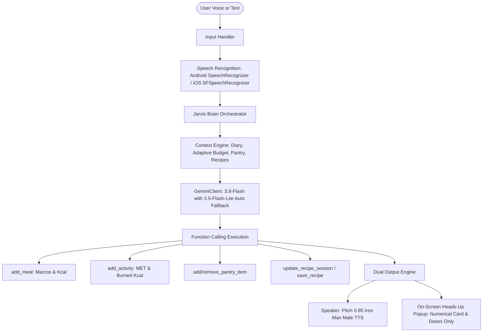

# JarvisFit Documentation & Architecture Overview

> **JarvisFit** is an AI-powered fitness, nutritional, and culinary voice assistant inspired by Iron Man's J.A.R.V.I.S., powered by **Google Gemini 3.8 / 3.5 Flash Lite** models with local native audio processing, continuous conversational intelligence, adaptive nutrition planning, smart pantry inventory, and persistent recipe management.

Available for:
- **Android**: Native Kotlin + Jetpack Compose (`app/`)
- **Apple / iOS**: Native Swift 5.9 + SwiftUI (`apple/JarvisFit/`)

---

## 1. System Architecture

---

## 2. Core Functional Modules

### A. Rolling Adaptive Nutrition Budget & Step-Adaptive Calories
Unlike traditional fitness apps that enforce rigid daily targets regardless of life events, **JarvisFit** uses a weekly rolling adaptive model combined with real-time movement adaptation:
- **Base TDEE & BMR**: Calculated via the Mifflin-St Jeor equation and physical parameters.
- **Weekly Self-Balancing**: If you exceed your calories yesterday (e.g. unexpected dinner/pizza), Jarvis does not trigger guilt or crash starvation diets. Instead, it computes:
  $$\text{Adaptive Daily Target} = \frac{\text{Remaining Weekly Budget}}{\text{Remaining Days in Week}}$$
  It redistributes the surplus gently over the rest of the week so you remain 100% on track for your long-term body composition target.
- **Dynamic Real-Time Steps & Activity Adaptation**:
  As the user walks throughout the day, daily calorie targets automatically expand:
  $$\text{Burned Kcal (Steps)} = \text{Steps} \times (0.0005 \times \text{Weight}_{\text{kg}})$$
  $$\text{Step Bonus Kcal} = \text{Burned Kcal (Steps)} \times 0.50$$
  $$\text{Today's Effective Target} = \text{Adaptive Daily Target} + (\text{Workout Burn} \times 0.50) + \text{Step Bonus Kcal}$$
  This prudent 50% allowance rewards daily physical activity and steps in real time without the risk of overeating, keeping both the UI dashboard and Jarvis AI conversational responses in sync.

### B. Smart Pantry & Multimodal Computer Vision
- Users can photograph their refrigerator, pantry, or groceries.
- Images are automatically downscaled and compressed to optimized JPEG format (80–120 KB) to prevent network upload timeouts.
- **Gemini Vision** recognizes items and registers them with categories (`proteins`, `carbohydrates`, `vegetables`, `dressings`, etc.).
- When asked *"What can I cook for dinner?"*, Jarvis designs recipes using primarily available pantry ingredients.

### C. Active Cooking Session & Persistent Recipe Book
1. **Active Cooking Session**:
   - When discussing a meal or cooking, Jarvis activates an on-screen **Cooking Banner**:
     > 🍳 **Cooking Now: [Recipe Title]** • Step: current phase • Ingredients: exact doses
   - Jarvis guides you step-by-step through the preparation process.
2. **Persistent Recipe Book**:
   - Tell Jarvis *"Save this recipe"* and it will store the recipe permanently with full macro breakdown (Protein, Carbs, Fat, Kcal) and preparation notes.
   - When preparing a saved recipe later, **Jarvis dynamically scales doses and ingredients** to match your remaining calorie budget for that specific day.

### D. Audio & Microphone Management
- **Background Wake-Word**: Listens for *"Jarvis"* to trigger the app even when the phone screen is off.
- **Dual Wake-Word Coexistence (Android)**:
  - Saying *"Jarvis"* triggers JarvisFit.
  - Saying *"Hey Google"* / *"Ok Google"* causes Jarvis to immediately release the audio focus and launch Google Assistant / Gemini.
- **Audio Focus Protection**: Jarvis monitors active media audio (`isMusicActive`). If you are watching videos (YouTube, TikTok, Instagram) or playing music, Jarvis will not interrupt or duck your media volume.

### E. On-Screen Data Popups vs. Voice Discourse
When interacting while multitasking or from other apps:
- **Spoken Output**: Jarvis speaks with an articulate, polite British/Iron Man tone.
- **Visual Notification**: A high-importance popup appears with **only schematic figures and instructions** (e.g., `🔥 Lunch: 520 kcal (P38 C45 G12) • Left: 680 kcal` or cooking doses), leaving out unnecessary conversational chatter.

---

## 3. iOS English Language Support

In the Apple/iOS edition (`apple/JarvisFit/`):
- A language toggle is available in **Profile > App Language**:
  - 🇮🇹 **Italiano** (Default)
  - 🇬🇧 **English**
- Switching to **English**:
  - Translates all tabs: `Today`, `Pantry`, `Recipes`, `Diary`, `Profile`.
  - Translates macro meters, active recipe banners, and system place-holders.
  - Configures the speech synthesizer to deep British English (`en-GB`).
  - Configures speech recognition to `en-US`.

---

## 4. API Resilience & Fallback Architecture

To eliminate mobile connection timeouts:
1. **Timeout Thresholds**: Connection timeout set to 25s, read timeout to 45s.
2. **Automatic Fast Fallback**: If `gemini-3.8-flash` experiences network latency or a socket timeout, the client transparently re-issues the request to `gemini-3.5-flash-lite`, ensuring an immediate response within 1–2 seconds.
3. **503 / 429 Demand Handling**: Includes automatic exponential backoff retry logic.
